I just had a fantastic long weekend tramping the [Aotea Track](https://www.doc.govt.nz/parks-and-recreation/places-to-go/auckland/places/great-barrier-island-aotea/things-to-do/tracks/aotea-track/) on [Great Barrier Island](https://en.wikipedia.org/wiki/Great_Barrier_Island), Friday to Sunday, with a group of eight people, many of them former colleagues from Google's Auckland office. It was the [third time](/2022/09/aotea-track-2022.html) I've done this track, but with a completely different set of people this time.

We flew from Auckland on Friday morning, got a shuttle to take us to the Forest Road trailhead near Whangaparapara, then walked to Kaiaraara Hut in about 4 hours. Kaiaraara Hut is an older style of hut but perfectly fine. After we dropped our gear and had a short break there, we decided to walk 5km on the road around the coast of Port Fitzroy to the Port Fitzroy store so some of our group could get beers, and to see the viewpoints around Port Fitzroy. We had a good time at the store and walked back. There was some thunder as a thunderstorm passed nearby, and a little rain, but nothing to bother us. A few of us stopped at Akapoua campsite for a swim on the way back. It was high tide and the water was surprisingly warm for this time of year. It was a lovely evening in the hut, and a tasty dinner except I had blundered and left the onions at home. After dark I went searching for glow-worms and found a lot on the banks of the track across the swingbridge not far from the hut.

On Saturday we took the South Fork track up to Mt Heale Hut. It only took us two and a half hours, and we weren't even that fast a group, so it was pretty easy, and we arrived at the hut before lunch. The view from that hut across to Little Barrier Island is extraordinary, and we had a great afternoon of relaxing in the hut and getting to know the other trampers sharing it with us. Some of us did the short walk up Mt Hobson, and one of my friends and I also added on Palmers Track to Windy Canyons and back. We moved pretty fast and overall it was three hours return to Windy Canyons from Mt Heale Hut --- not three hours each way as the brochure in the hut says! Unfortunately it was pretty cloudy around the peaks so we didn't see anything from the summit. We had a great night playing [Saboteur: The Dark Cave](https://boardgamegeek.com/boardgame/365702/saboteur-the-dark-cave) with all eight of us --- some of our group were initially intimidated by the apparent complexity but it really isn't that bad, and by the end everyone was into it. Oh, we also heard about some New Zealand election results.

On Sunday we strolled down Peach Tree Track to the Kaitoke hot springs. Perhaps because there hadn't been much rain recently, the upstream pools were very hot indeed, almost unbearable, but they cool the further downstream you go so there's always a pool that's just about right. This was a gorgeous warm sunny day so it was a great time. After lunch we continued our walk out to Whangaparapara Road and then along the road to Claris, for a quick afternoon tea break --- drinks and ice-cream. Across the road to the airport, I discovered my second blunder of the trip --- I'd booked my flight for 1pm instead of 3pm, so I had to rebook for 6:15pm. In the end it wasn't a big deal; a couple of my friends also had later flights, so we walked to Kaitoke Beach for a swim, which was absolutely marvellous --- colder than Port Fitzroy, but surf pounding into a gloriously long sandy beach with only a couple of other people to be seen.

Great Barrier Island is really an amazing place. Most Aucklanders I talk to about it have never been there, despite it being practically in their backyard. Yes, you have to pay for the ferry or plane ($120 pp each way for the ferry, about $300 each way for the plane), unless you have a boat or a friend with a boat to take you there --- but it's a very special place, and I hear you can sometimes get great deals from Great Barrier Air on Instagram. On a good day you can see the island from the mainland, and it's only a half-hour flight in the Cessna Caravan, but on the island it feels, and in all ways that matter *is*, quite remote. Even if you're not hiking the Aotea Track, there are many fine day walks and stunning beaches to explore.

It's also interesting to consider that living and even working "off the grid" on the Barrier is getting ever more practical thanks to Starlink and cheap solar power. The good side of technology!

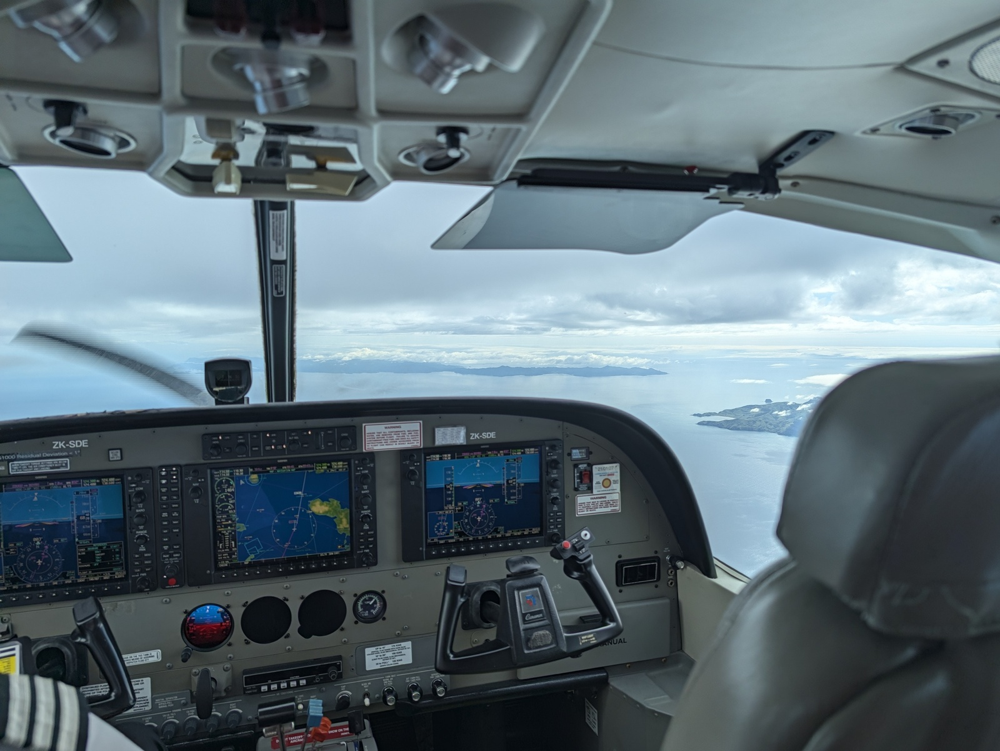

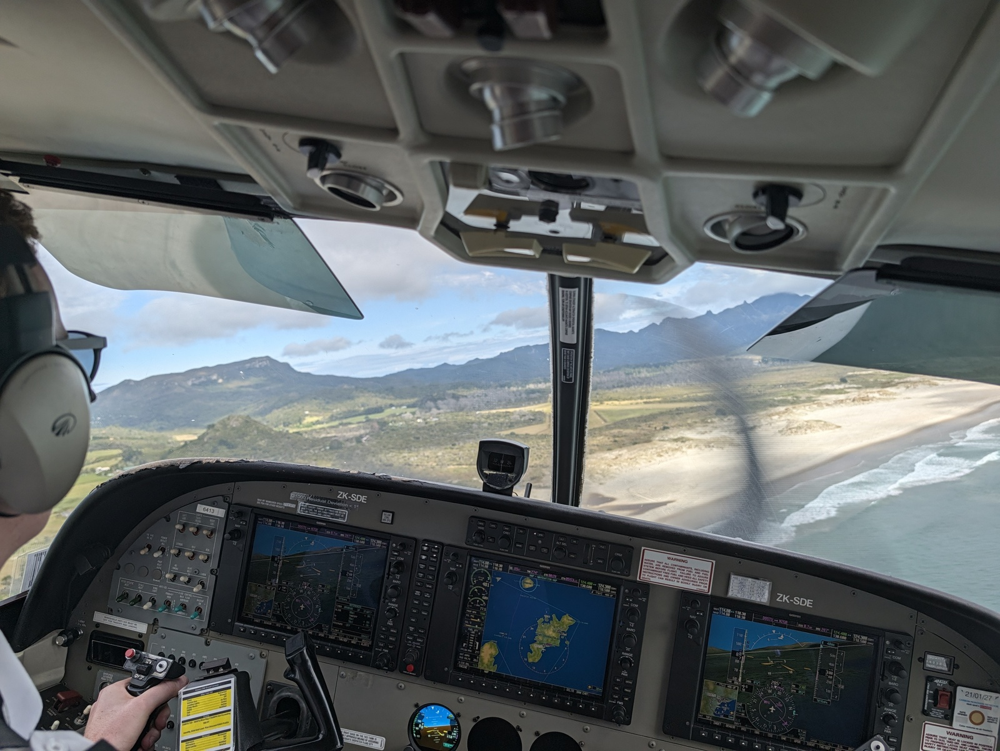

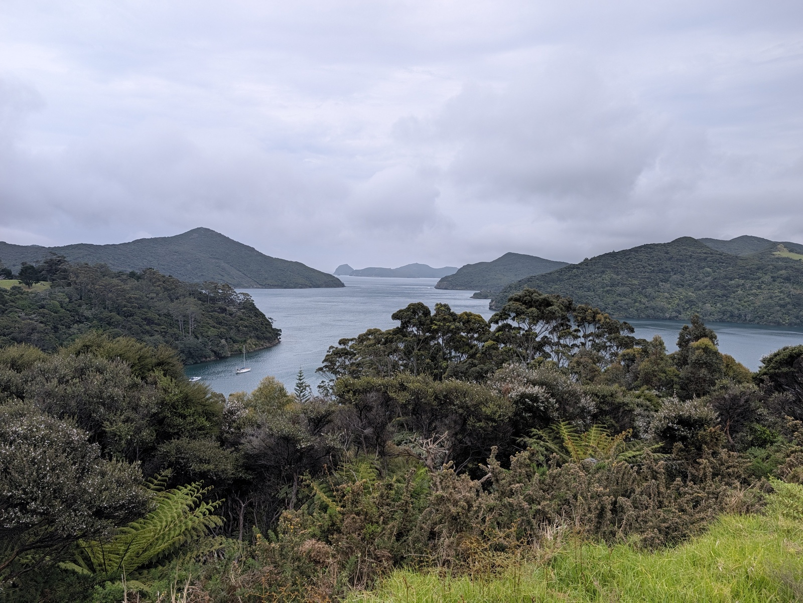

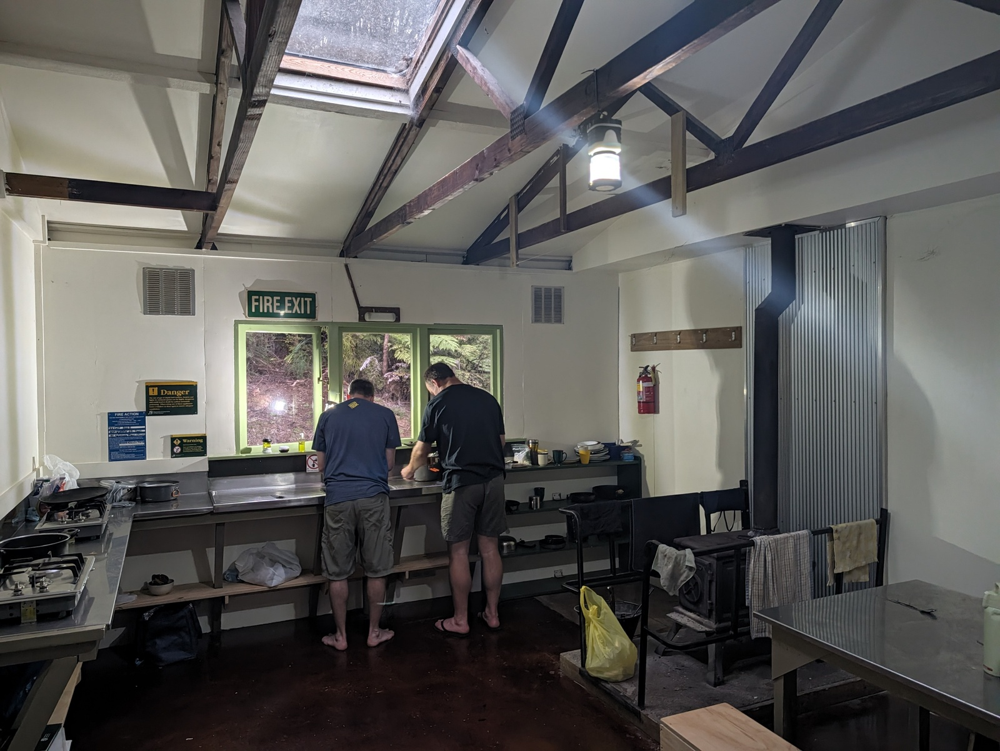

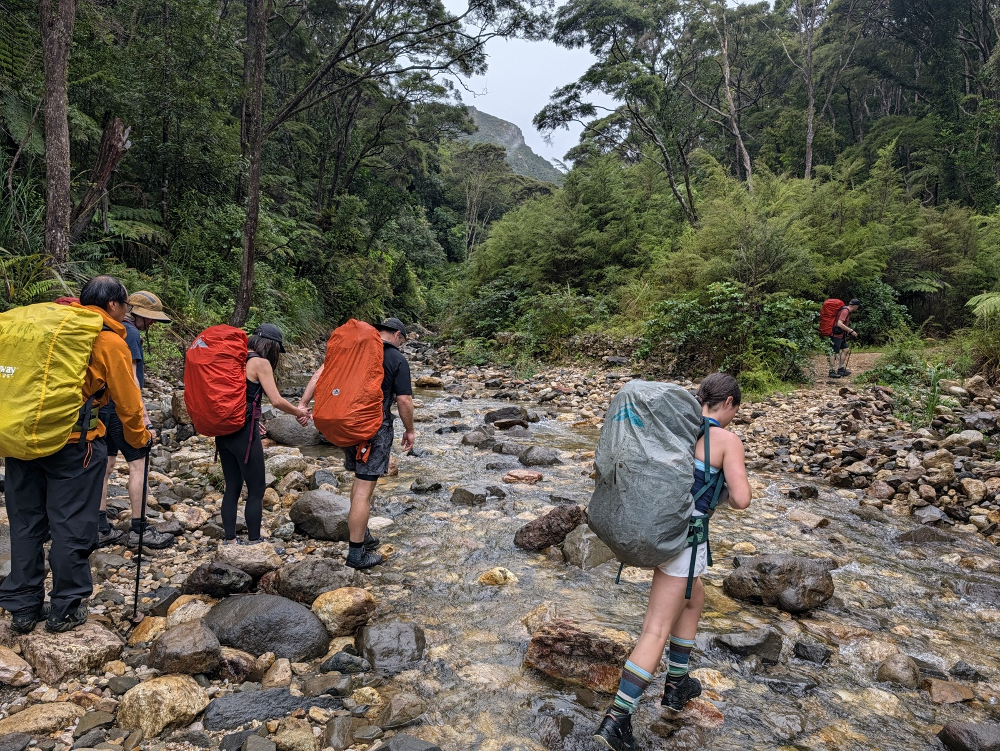

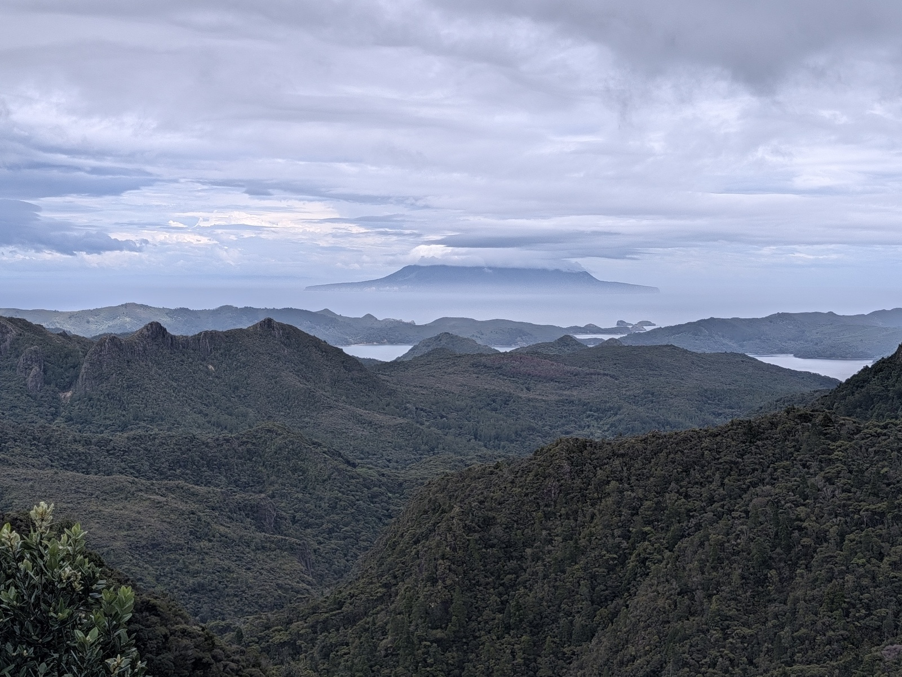

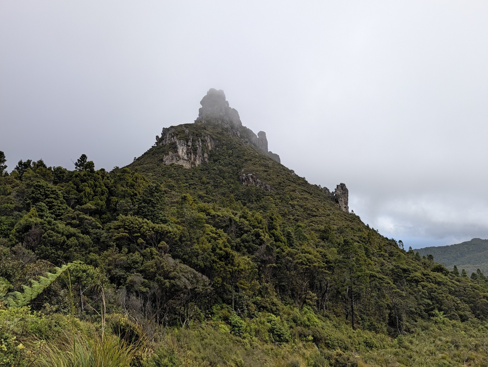

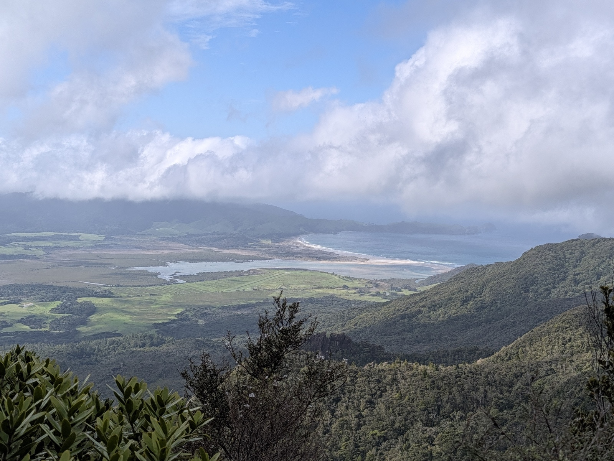

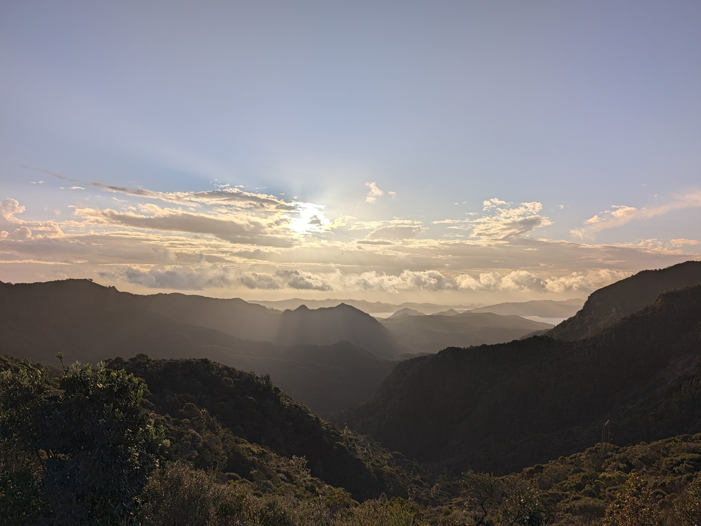

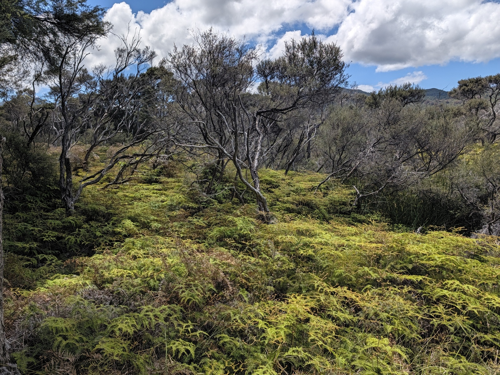

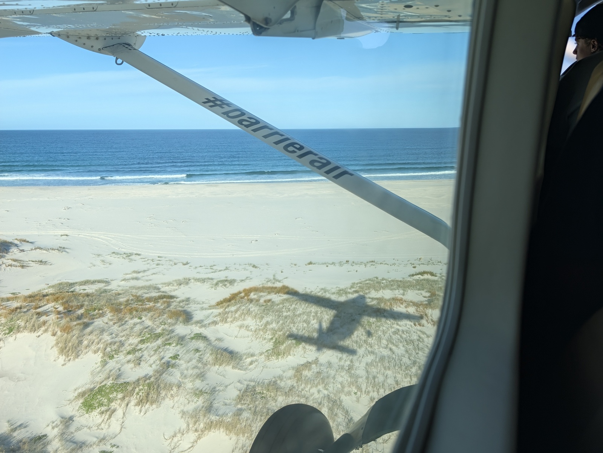

